# Pi persistent service evidence

Matching fixture captures from main `ff52f741` and this migration. Both use the same classroom, lesson, panel message, viewports, and themes. The base bridge ends without a reply; the after fixture reports a specific Pi model error. These comparisons prove UI behavior, not model behavior or human learning.

| State                    | Before                                                            | After                                                             |
| ------------------------ | ----------------------------------------------------------------- | ----------------------------------------------------------------- |
| light, desktop, settings | 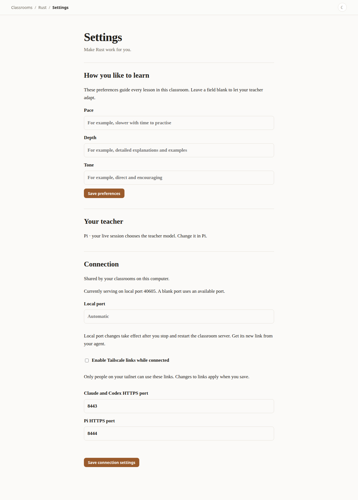 | 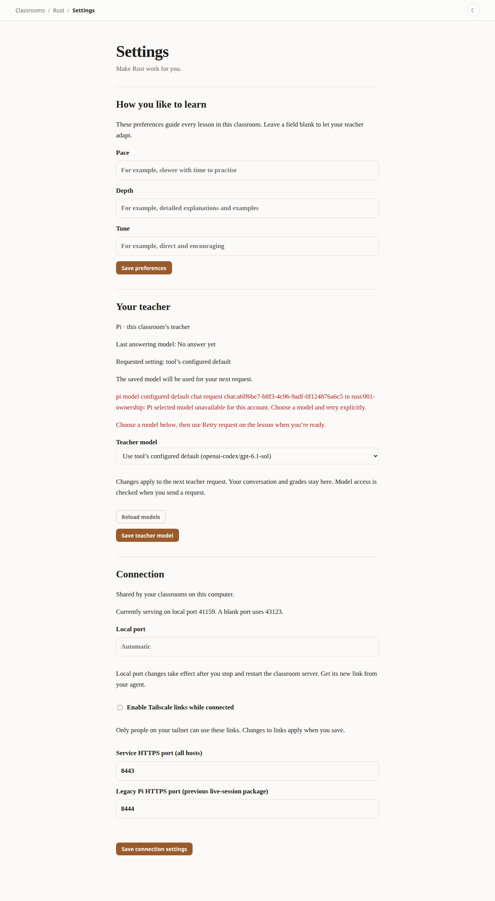 |
| light, desktop, teacher  | 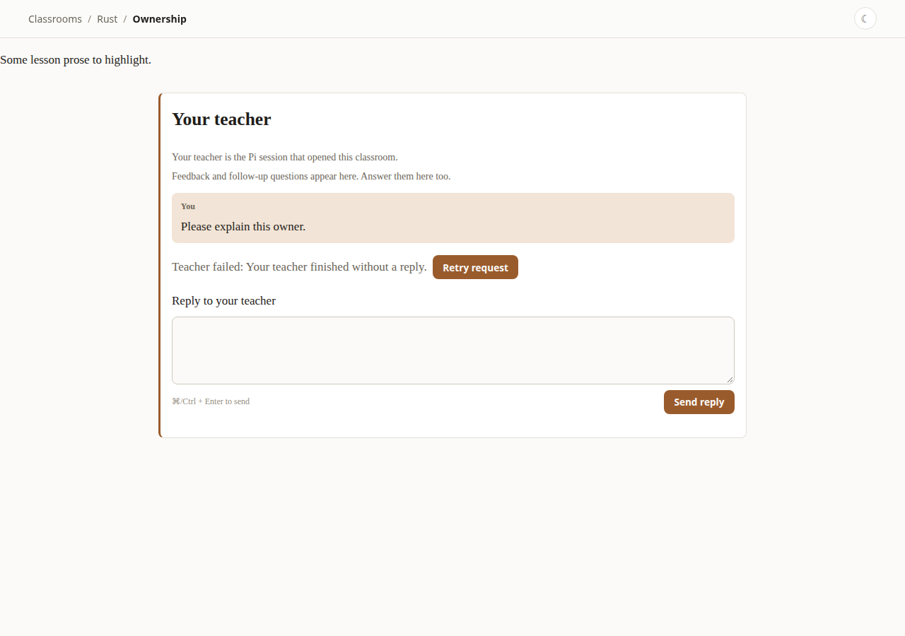   | 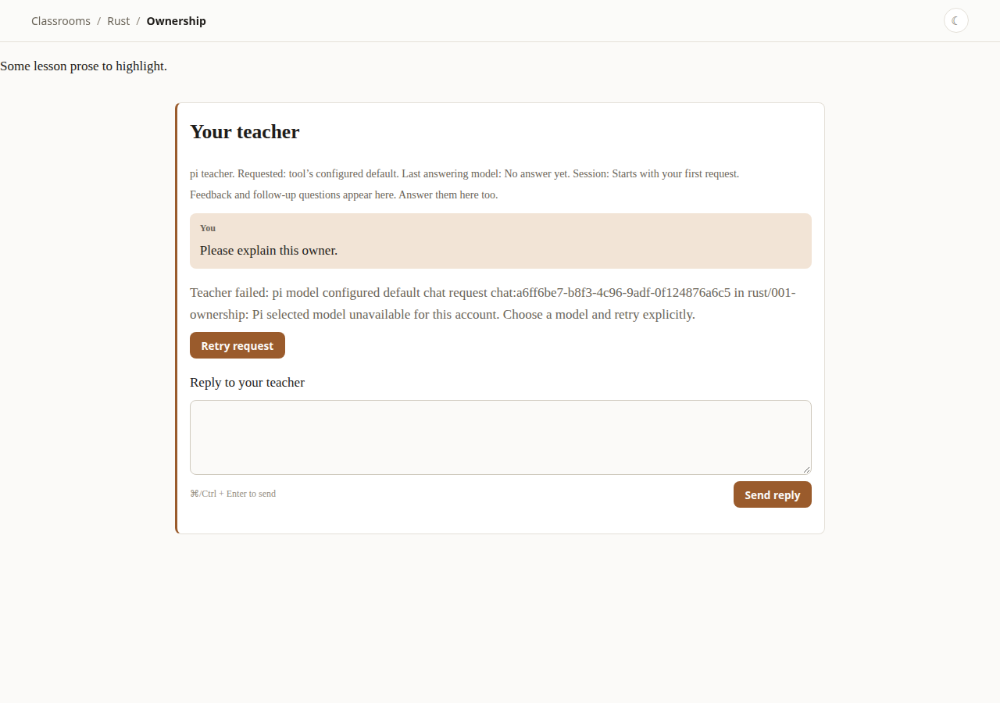   |
| light, mobile, settings  | 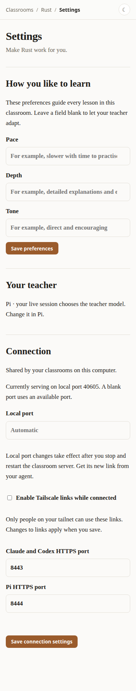   | 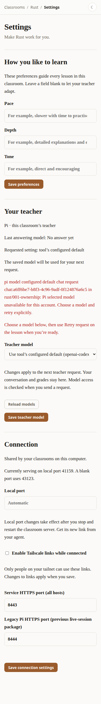   |
| light, mobile, teacher   | 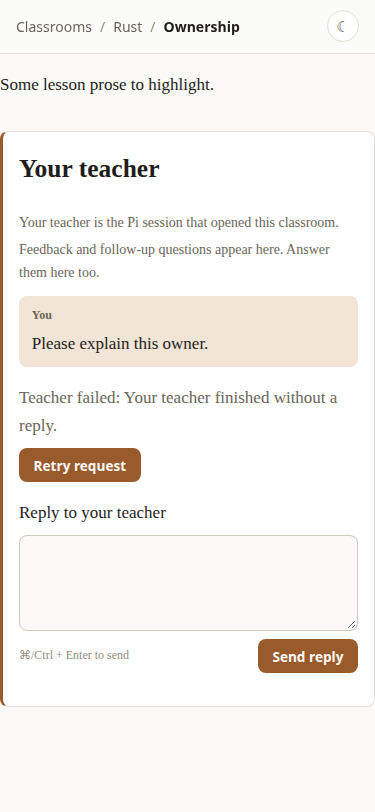     | 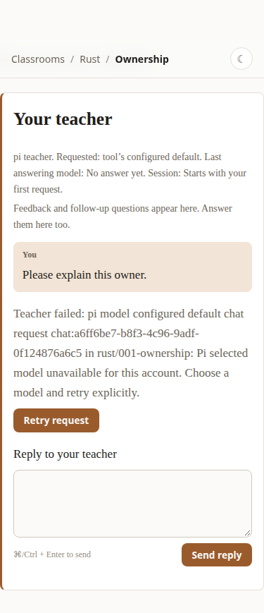     |
| dark, desktop, settings  | 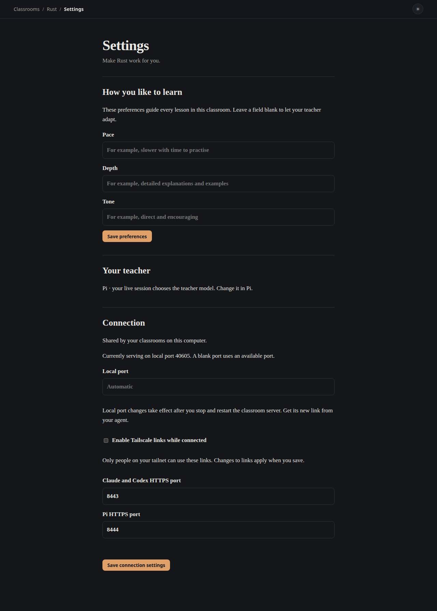   | 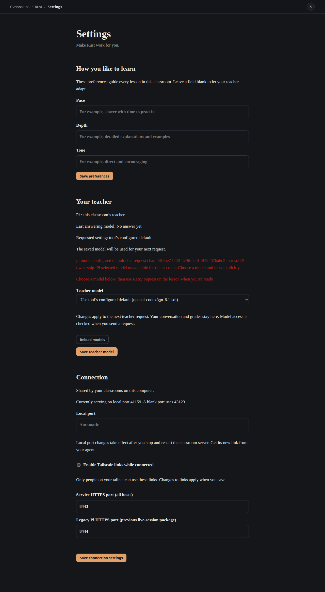   |
| dark, desktop, teacher   | 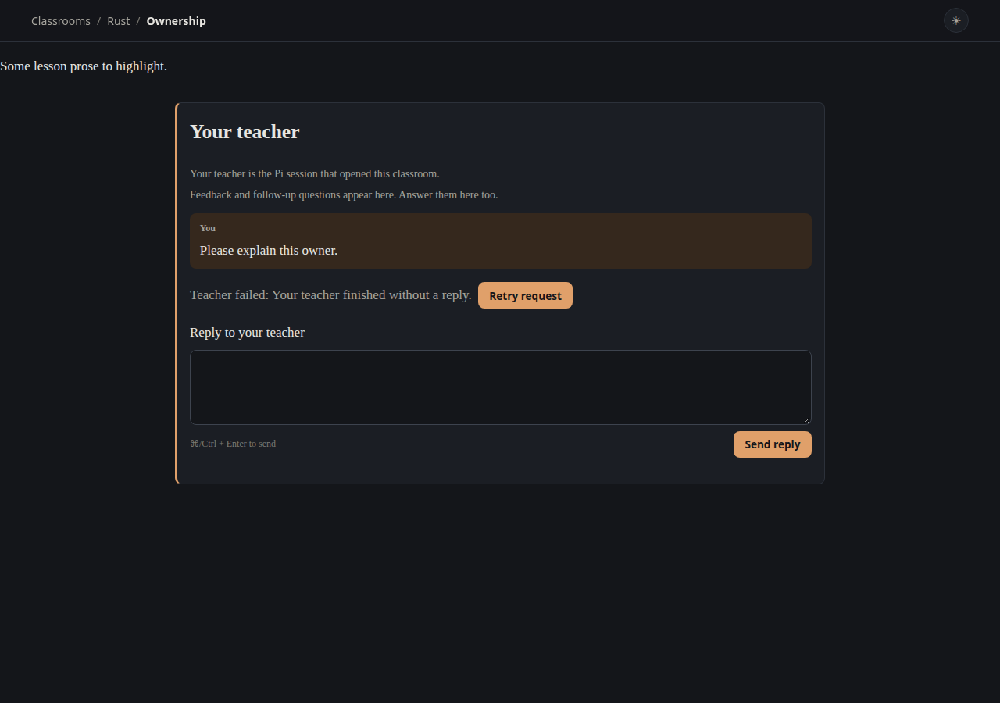     | 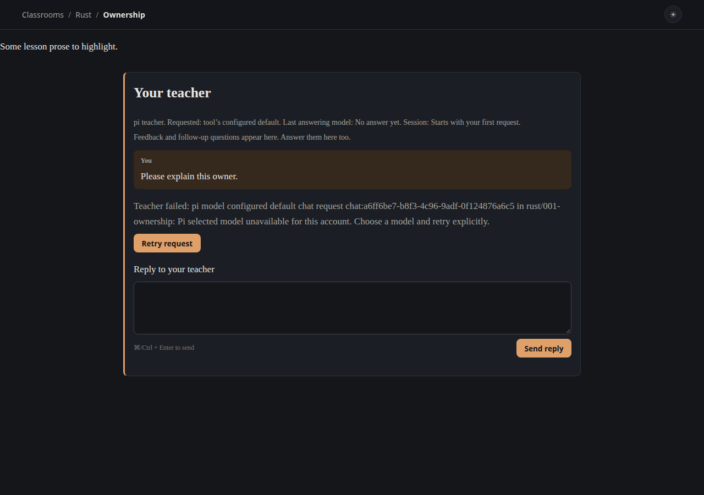     |
| dark, mobile, settings   | 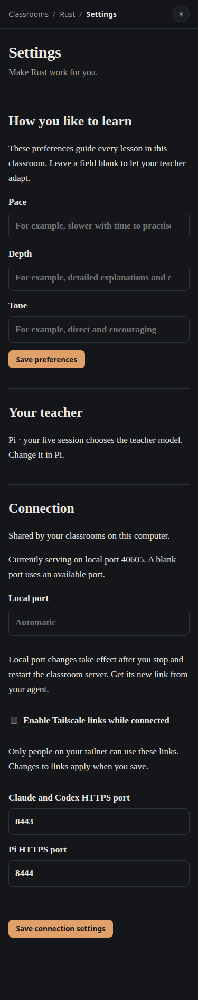     | 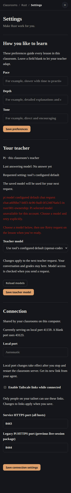     |
| dark, mobile, teacher    | 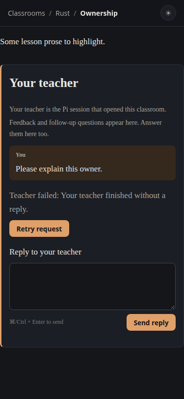       | 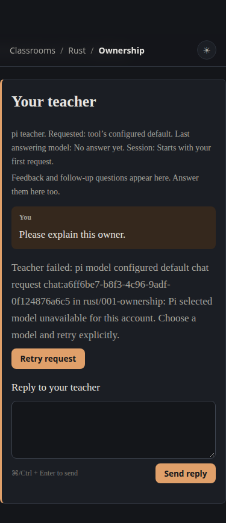       |

Desktop: 1280×900. Mobile: 375×812. Full-page images can be taller than the viewport. Source ports and generated request IDs differ. See [capture provenance](provenance.json) for inspected image hashes and source hashes.
