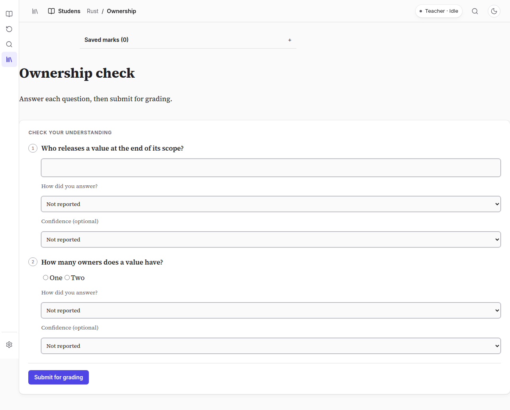
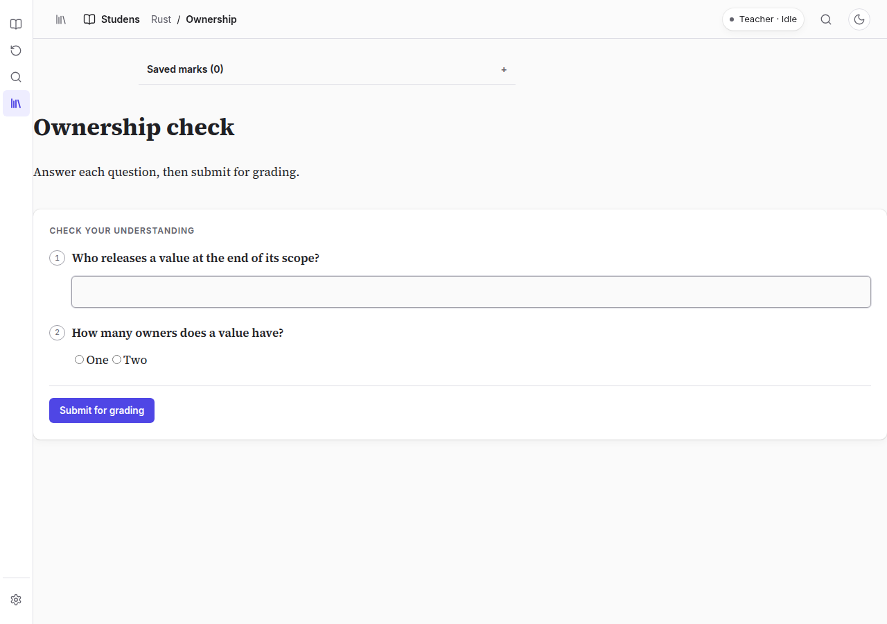
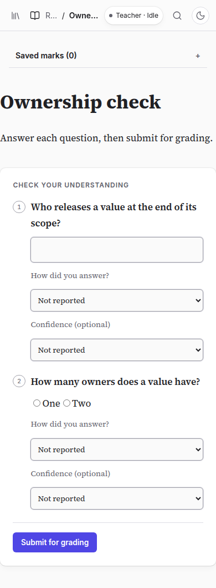
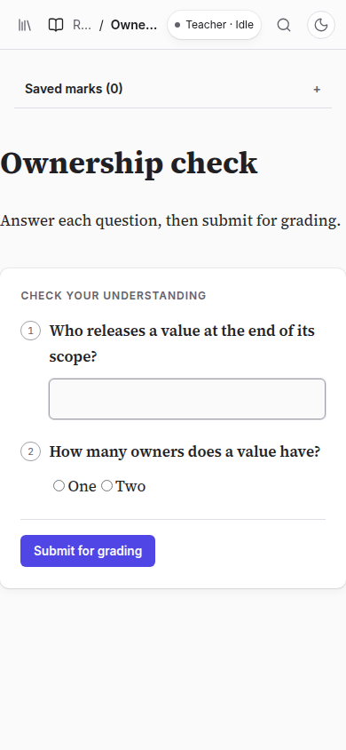
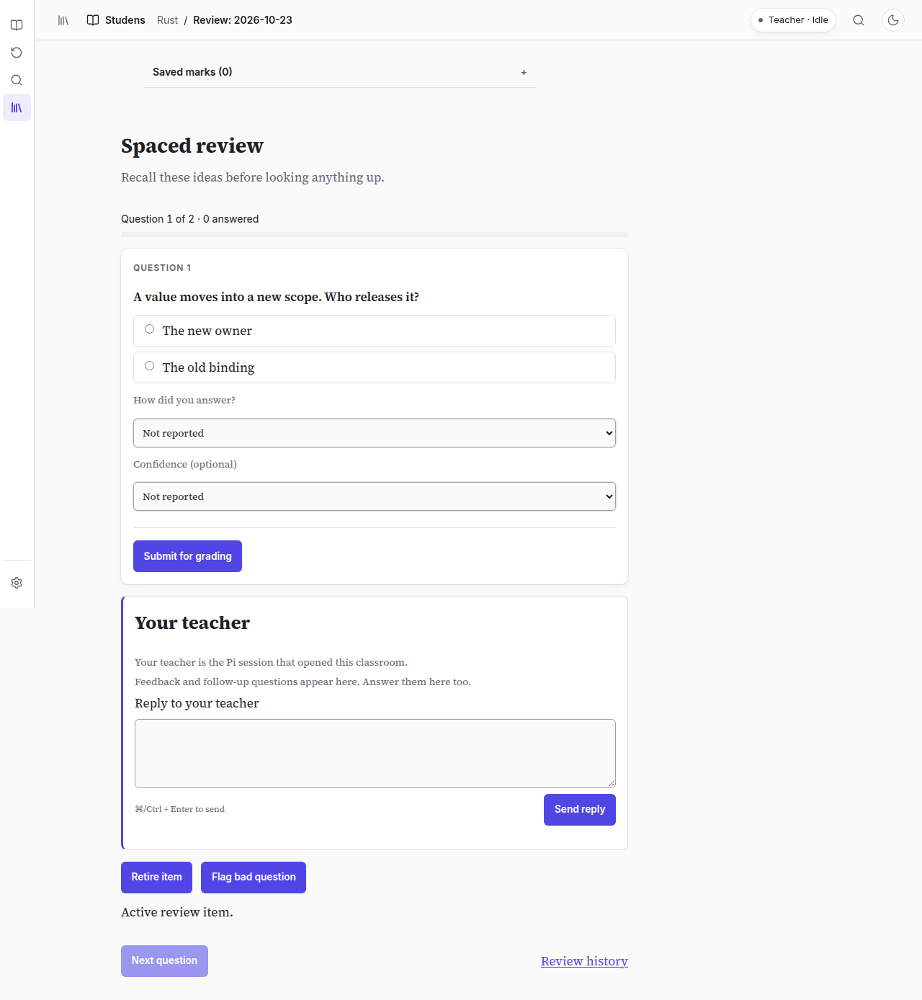
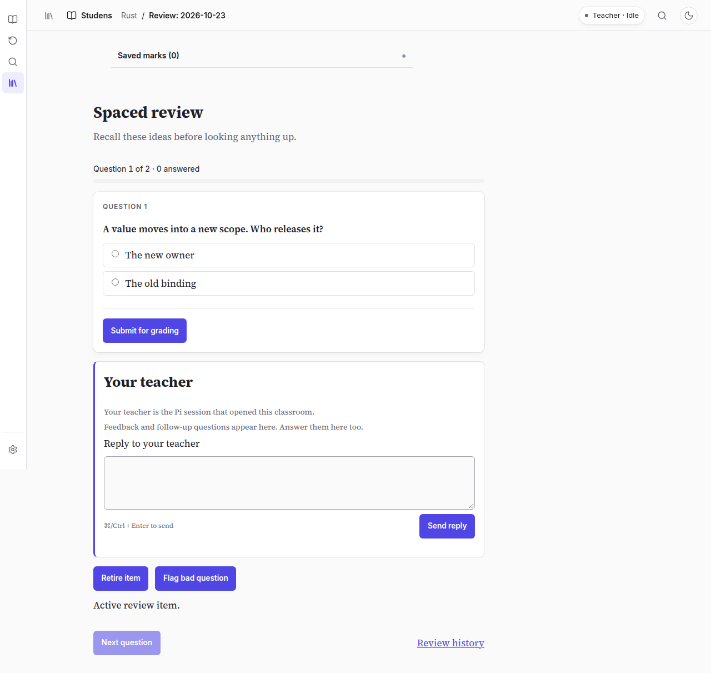
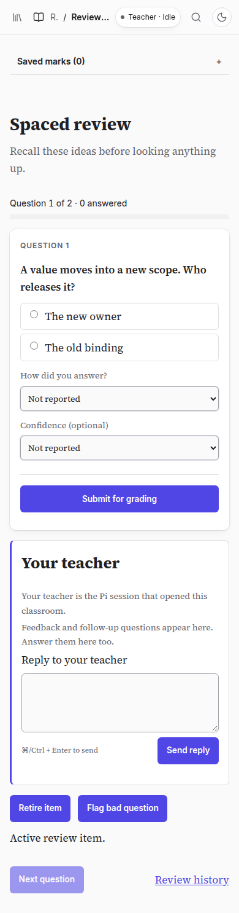
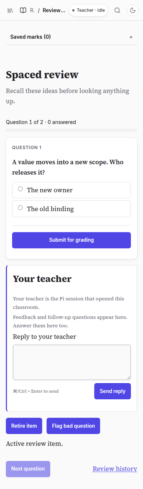

# Correctness and elapsed-time review evidence

Captured from the running application and inspected before publication. Before captures use archived main `6f622b99bdce496328af8a2594542dd09c90a017`. After captures use the verified implementation in this PR.

| Screen         | Before                                      | After                                     |
| -------------- | ------------------------------------------- | ----------------------------------------- |
| Quiz desktop   |      |      |
| Quiz phone     |        |        |
| Review desktop |  |  |
| Review phone   |    |    |

Same fixture content and fresh unanswered state within each pair. Quiz viewports: 1280 × 900 and 390 × 844. Review viewports: 1280 × 844 and 390 × 844. Full-page captures can exceed viewport height. Confidence and help-used controls disappear while the answer and submit controls remain.

`verification.json` records the successful default run, exact changed-source hashes, capture hashes, and coverage limits. The full default run passed formatting, types, version consistency, 1,434 tests, and the complete browser suite. Focused workload/root and daily Pi/service fixture drives also passed. Owner fixtures prove routing, persistence, and browser behavior; real model connections and native authoring were not run. There is no model-quality or human-learning claim.

The default run predates adding these evidence files; no product or harness source changed afterward. Historical assistance remains readable and omitted help remains unknown.
